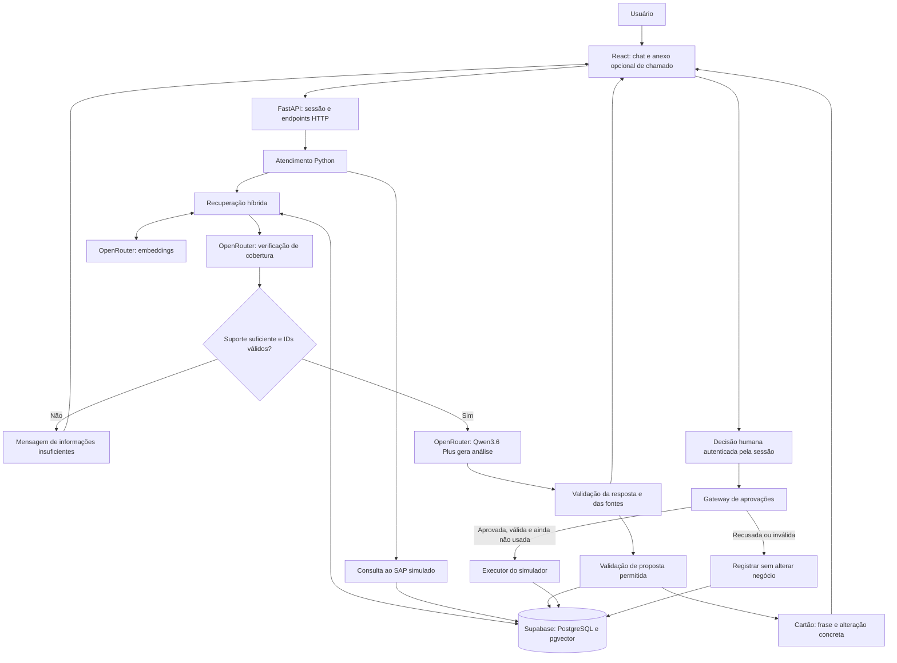

# Arquitetura e contratos

## Stack e responsabilidades

**Decisão confirmada:** Python/FastAPI + React/TypeScript/Vite; Supabase com PostgreSQL/pgvector; OpenRouter para chat e embeddings. O HITL será um módulo do servidor, sem microsserviço obrigatório. A regra de autorização independe da interface.

**Estado implementado em 18/10/2026:** núcleo em `sap_assistant/`, interface em `frontend/` e entrada ASGI em `app.py`, fontes em `conhecimento/` e prompt versionado em `prompts/system.txt`. Persistência SQLAlchemy com seis tabelas no schema exclusivo `sap_chamados_ai`. SQLite é usado somente nos testes; a configuração de execução exige PostgreSQL/Supabase. A inicialização recusa schema sem identificação compatível e não altera objetos de outros projetos.

**Atualização implementada:** 12 guias; recuperação de até quatro sínteses oficiais e duas políticas do simulador. `grounding.py` verifica a suficiência antes da geração, com contrato `KnowledgeAssessment` e parágrafos identificados. O adaptador OpenRouter faz uma chamada de cobertura e, somente se aprovada, uma chamada de análise. Ausência ou prova inválida de suporte produz abstinência padronizada, sem proposta. A UI mostra links diretos, sem conteúdo ou popup de fonte.

**Atualização implementada:** `cases.py` padroniza referências e campos de apresentação, sem escrita de negócio. A busca e os filtros da interface atual são locais no React. `fixtures.py` acrescenta perfis de suporte inspirados no SAP for Me somente às novas sessões, no JSON de `sap_workspaces`; não requer tabelas adicionais nem migração SQL. Sessões antigas sem perfil permanecem válidas. `service.py` trata os metadados de abertura como relato fictício, separado de dados atuais e conhecimento. Seletores de chat/lista são estado de interface e não invocam o atendimento automaticamente.

**Decisão confirmada e implementada, substituindo a seleção obrigatória:** chat único com anexo de chamado opcional. `analyze(context, None, message)` atende perguntas gerais do escopo pelo RAG, sem consultar pedidos simulados ou carregar o histórico de chamados anteriores. Mensagens gerais usam o canal interno `__geral__` no campo de texto existente; não é um chamado nem um novo registro de negócio. Não há migração SQL.

A apresentação carrega a linha do tempo da conversa autorizada por `Store.snapshot(context, chat_id)`; o contexto enviado ao modelo continua filtrado pelo chamado anexado ou pelo canal geral. Cada mensagem nova guarda `details.attachment` com ID, referência e título, ou `null`. Remover o anexo afeta apenas as próximas perguntas e não reescreve mensagens, propostas ou dados do chamado. Leituras globais de mensagens/propostas continuam exigindo autorização da sessão. Histórico antigo segue legível pelo vínculo já persistido.

Sem anexo, `ticket=null` e `case_attached=false` chegam ao provedor; a recuperação usa a pergunta, sem título/relato de um caso anterior e sem evidência `DATA`. A exigência de suporte no RAG permanece. Propostas sem chamado são bloqueadas pelo servidor antes do gateway; o modelo não escolhe um chamado por conta própria. Aprovação pendente só mostra botões de decisão quando seu chamado está anexado; remover o anexo permite conversar no canal geral sem conceder ou cancelar autorização.

**Decisão confirmada — conversas independentes:** Novo chat cria um UUID no servidor, limpa o contexto visual e mantém o mesmo workspace/dados de negócio. `details.chat_id` identifica mensagens; `payload.chat_id` identifica a proposta e integra seu hash de integridade. Mensagens e propostas legadas, sem campo ou com `null`, pertencem à conversa inicial. Filtros JSON selecionam a conversa atual na leitura de apresentação e no histórico do LLM; a autorização de workspace permanece obrigatória. O cache inclui o ID de conversa. Não há novas tabelas, alteração de schema ou migração SQL.

O identificador vem do endpoint de conversa no servidor, fora dos argumentos do modelo. A chave de submissão não pode ser reutilizada em outra conversa. Deduplicar propostas somente dentro da mesma conversa; decidir exige correspondência com a conversa da proposta, além de todas as validações anteriores. Conversas vazias só precisam do estado de interface; os registros persistem quando há mensagens/propostas. Novo chat não apaga nem resolve o atendimento anterior, não renova sua aprovação e não reinicia cotas da sessão.

**Apresentação compacta:** `render_analysis` produz resumo, citações e um único próximo passo ou pergunta de esclarecimento, preservando avisos obrigatórios. `detailed=True` disponibiliza os fatos e verificações completos para o expansível da UI. O contrato estruturado e os snapshots de evidências continuam integrais. Respostas históricas já salvas não são reescritas.

## Fronteira web atual

**Decisão confirmada:** Streamlit removido por solicitação do usuário devido às travadas percebidas. React mantém interações locais; FastAPI fornece API e serve o build Vite. Hospedagem sem plataforma definida, com deploy manual posterior pelo usuário. Não houve alteração de tabelas ou migração do banco.

| Endpoint | Contrato |
| --- | --- |
| `GET /api/health`, `GET /api/config` | Saúde do processo e indicação de exigência de código; sem credenciais. |
| `POST /api/session`, `GET /api/session` | Criação/validação de sessão; cookie opaco HttpOnly, SameSite estrito, Secure fora de local. |
| `POST /api/chats` | Novo identificador de conversa, preservando o workspace. |
| `GET /api/chats/{id}` | Projeção pública da conversa, casos e propostas, sem textos brutos de evidência. `initial` representa a conversa legada. |
| `POST /api/chats/{id}/messages` | Mensagem, anexo opcional e UUID de submissão; NDJSON com etapas, heartbeat e resultado validado. |
| `POST /api/chats/{id}/proposals/{id}/decision` | Somente `approve: boolean`; operação e parâmetros vêm da proposta persistida. |

Mutações exigem cabeçalho da aplicação e verificação de Origin/Host quando Origin está presente. Sem CORS aberto. Sessão é autorizada no banco; a identidade nunca vem do modelo. A resposta pública omite tokens, DSN, conteúdo de documentos e envelopes internos. Erros não expõem stack trace ou detalhes do provedor.

As análises rodam em executor limitado a quatro tarefas por processo e uma por workspace; a API continua atendendo consultas e navegação. Falha de rede não reenvia a análise automaticamente. Após falha ou sucesso, a tela tenta reler o estado durável. Etapas não contêm resposta técnica parcial. Aguardar humano não ocupa tarefa: o resultado pendente é persistido e a requisição termina.

A sessão é validada por cookie; `sessionStorage` guarda apenas conversa/anexo, nunca token. Reiniciar o servidor permite retomar enquanto o cookie válido existir. Não há autenticação individual ou retomada entre dispositivos. Escala com múltiplos processos exigirá coordenação compartilhada do limite de tarefas; o gateway mantém sua idempotência transacional independentemente desse limite.

## Desempenho da apresentação

**Diagnóstico histórico da versão substituída:** cada rerun da tela repetia cinco SELECTs em três acessos separados ao Supabase (`state`, `messages`, `proposals`), com nova autorização/conexão/transação por acesso. No AppTest com banco real, selecionar/anexar/remover demorava cerca de 2,7 segundos, sem LLM. O [modelo de execução do Streamlit](https://docs.streamlit.io/develop/concepts/architecture/caching) contribui ao reexecutar o script nas interações; o custo de rede repetido era evitável.

**Recomendação técnica implementada:** `Store.snapshot(context)` lê estado, mensagens e propostas com autorização e três SELECTs na mesma conexão, sem `FOR UPDATE`, escrita ou decisão. A interface mantém a projeção pública desse resultado no estado React, associada à sessão e à conversa. Não usar cache compartilhado para dados privados. Navegar, buscar, anexar e remover reutilizam a leitura. Análises, decisões (inclusive falhas) e o botão Atualizar invalidam a cópia visual; mudança de sessão exige nova leitura autorizada.

Isso é uma cópia para exibição, sem atualização automática de mudanças externas: usar Atualizar nesses casos. Toda decisão continua consultando o Supabase atual sob os bloqueios do gateway, mesmo quando o cartão exibido está antigo. `visible_proposals` deriva vencimento a cada leitura pelo relógio do servidor; a tela avança o prazo localmente, calibrada pelo horário enviado na resposta, sem mutar o snapshot/banco ou renovar prazo. O gateway valida o vencimento novamente ao decidir. A auditoria persistida de expiração ocorre nos caminhos existentes de decisão/leitura de propostas, não por navegação em memória.

`synchronize_knowledge` carrega os documentos próprios em lote antes de comparar hashes, evitando 12 consultas sequenciais de inicialização. A análise mantém busca, verificação de cobertura e geração separadas; não se remove uma validação para aparentar rapidez. Um callback do servidor informa as etapas reais na tela, sem transmitir JSON/resposta técnica antes da validação. Medidas e limitações em [evidências](../evidencias/README.md).

Contratos implementados: `Analysis`, `Evidence`, `ReceiptRequest`, `StatusRequest` e `SessionContext`; `Proposal` representa o envelope persistido no servidor. O LLM retorna JSON tipado com proposta opcional. Não recebe executor, mecanismo de decisão, SQL ou cliente HTTP como ferramentas. O esquema é enviado também no prompt, pois o endpoint pode traduzir saída estruturada para JSON mode; a validação Pydantic e de referências permanece obrigatória. O raciocínio interno do modelo foi desativado para essa interação estruturada e não é usado como trilha de execução.

**Recomendação:** usar Pydantic para contratos, cliente HTTP com timeout para o OpenRouter e acesso transacional ao PostgreSQL. Manter um único fluxo de atendimento com estados explícitos. Não adicionar multiagentes, Redis, fila ou framework de agentes sem necessidade demonstrada.

| Componente | Responsabilidade | Limite |
| --- | --- | --- |
| Interface React e API FastAPI | Seleção do chamado, mensagens, evidências e decisão humana | Não decide autorização pelo texto do modelo. |
| Atendimento | Coordena interpretação, consultas, esclarecimento e resposta | Não executa escritas diretamente. |
| Recuperação | Busca textual/vetorial e seleção de evidências | Não indexa instruções do projeto ou gabaritos. |
| Cobertura | Avaliação semântica dos trechos e validação de seus IDs de parágrafo | Não gerar análise técnica sem suporte; políticas simuladas não provam comportamento do SAP real. |
| Adaptador OpenRouter | Envia entradas, recebe e valida respostas | Não recebe credenciais do banco nem ferramenta de aprovação. |
| Aprovações | Valida propostas, registra decisão e controla execução | Política determinística detalhada em [HITL](07-aprovacoes-humanas.md). |
| SAP simulado | Consultas e operações permitidas sobre dados fictícios | Executor de escrita acessível apenas pelo módulo de aprovações. |
| Persistência | Conversas, evidências, estado, versões e auditoria | Toda consulta de dados privados filtra a sessão autorizada. |

## Fluxo

Fluxo conceitual da implementação atual:

Não manter uma requisição ou chamada de LLM aberta enquanto se espera o humano. Persistir a proposta pendente e terminar o atendimento atual. O clique inicia uma nova operação do servidor; não depende de reiniciar o raciocínio do modelo.

## Contratos mínimos

**Estado implementado:** contratos internos tipados e fronteira HTTP validada com Pydantic. Identificadores de sessão/autorização são fornecidos pelo servidor, fora dos argumentos controláveis pelo modelo.

| Contrato | Campos e comportamento |
| --- | --- |
| `ContextoDaSessao` | Identificador interno, contexto de autorização e chamado acessível. Nunca aceitar identidade declarada pelo LLM. |
| `Evidencia` | ID do trecho/consulta, origem, título, conteúdo, versão e escopo de aplicação; URL oficial quando houver. |
| `AnaliseDoChamado` | Resumo, processo, fatos com evidências, hipóteses, dados faltantes, verificações, referências, confiança e justificativa, necessidade de revisão e proposta opcional. |
| `PedidoDeAcao` | Operação enumerada, parâmetros específicos e frase de solicitação gerada pela IA. Sem URL, método HTTP ou código arbitrário. |
| `PropostaDeAcao` | Pedido validado, ID gerado no servidor, sessão/chamado, versões, hash canônico, resumo do efeito, timestamps e estado. |
| `DecisaoHumana` | ID da proposta e escolha Sim/Não; contexto do usuário/sessão obtido no servidor. Não aceita parâmetros novos da operação. |
| `ResultadoDaExecucao` | Estado final, ID da execução, efeito confirmado pelo simulador ou erro; não afirmar sucesso antes do commit. |

Interfaces conceituais: analisar chamado, consultar pedido, buscar evidências, verificar cobertura, propor ação e decidir aprovação. A execução é exclusivamente interna ao gateway. O código atual fornece consultas no contexto e recebe a proposta no JSON; não envia ferramentas de aprovação ou execução ao LLM.

## Persistência e isolamento

**Decisão confirmada:** banco externo durável para conversas, aprovações e auditoria. O estado React mantém seleção e referências de interface, nunca prova de aprovação. Arquivos locais não são armazenamento durável.

**Recomendação:** separar documentos/trechos compartilhados e imutáveis dos dados de cada sessão: chamados, mensagens, execuções de análise, evidências utilizadas, propostas, decisões e eventos de auditoria. Versionar os registros de negócio e usar restrições únicas para execução de uma proposta.

Cada visitante recebe uma sessão imprevisível, criada no servidor, com seu ambiente fictício. Criar o estado inicial a partir das fixtures é provisionamento da demonstração, não uma ferramenta de negócio disponível à IA. Não alterar dados de outra sessão nem reutilizar seus caches de conversa. Perder o contexto da sessão não concede acesso a propostas antigas; elas expiram ou são recriadas a partir de uma nova análise.

Na retomada após reinício, reconstruir estado a partir do banco somente quando a identidade da sessão puder ser verificada. Login de usuários reais e retomada entre dispositivos ficam fora da primeira versão. Restringir o acesso à demonstração antes de disponibilizar uma chave paga para visitantes externos; ver [entrega](09-execucao-e-entrega.md).

## Falhas e observabilidade

**Recomendação:** registrar IDs de correlação, modelo solicitado/efetivo, versão do prompt e da base, fontes recuperadas/utilizadas, latência, uso informado pelo provedor e estado da proposta. Dados ausentes de consumo devem ficar como indisponíveis, nunca como zero estimado.

Aplicar timeout e tentativas limitadas a chamadas de leitura/LLM. Falha do banco impede escrita e aprovação; falha do LLM produz erro claro sem fabricar resposta. Validar integralmente a saída antes de criar propostas. Reenvios HTTP não podem repetir cobranças ou operações já concluídas: correlacionar cada submissão com um ID e recuperar seu resultado.

## Correção com dados complementados pelo humano

**Decisão confirmada e implementada:** `Analysis.correction_operation` identifica recebimento ou mudança de situação quando falta um parâmetro humano. `corrections.py` cria um rascunho somente com chamado autorizado, contexto consultado e elegibilidade; o JSON da mensagem guarda operação, dados/fingerprints e validade. A projeção pública omite fingerprints e não escolhe quantidade/data.

`POST /api/chats/{id}/messages/{message_id}/correction` recebe `CorrectionInput` e usa o gateway para preparar, sem executar. A mensagem deve pertencer à sessão/conversa atual, ser a análise mais recente do caso e manter dados/validade. Repetição idêntica recupera a proposta anterior. O endpoint de decisão permanece separado e recebe somente `approve`. A complementação não chama o OpenRouter; auditoria e propostas continuam nas seis tabelas próprias existentes.

No React, a transformação de marcadores `[n]` consulta apenas metadados validados da resposta. URLs oficiais abrem diretamente; regras internas focam sua identificação no expansível da própria mensagem. A transformação também atende mensagens antigas sem reescrever o histórico; ignora código e não inventa links para números desconhecidos.

## Perguntas sobre estado do anexo

**Correção implementada após teste como usuário:** `application_context.py` identifica perguntas específicas de estado da interface, como qual chamado está anexado. A resposta vem do contexto autenticado/consulta simulada, sem LLM, RAG ou proposta. Novo chat e remoção do anexo não herdam o pedido anterior. A mensagem e o evento de leitura continuam auditados. O reconhecimento é restrito a perguntas completas desse tipo: um pedido técnico ou uma instrução adicional não usa essa exceção para contornar a cobertura do RAG. Essa resposta não declara uma orientação técnica SAP nem comprova um lançamento.
