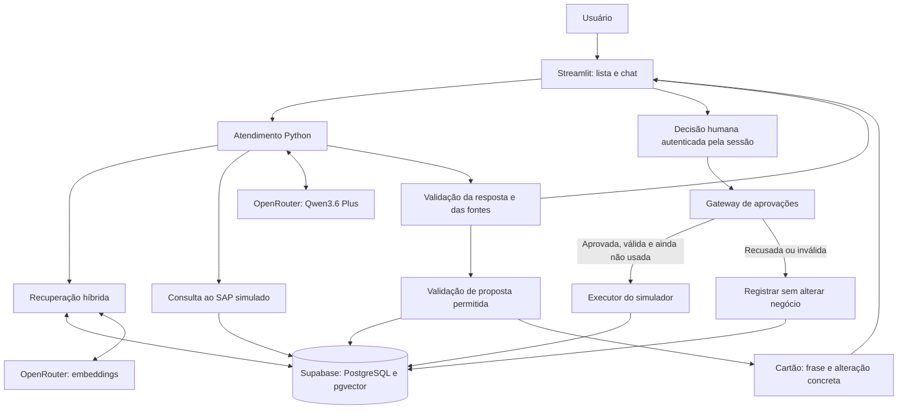

# Arquitetura e contratos

## Stack e responsabilidades

**Decisão confirmada:** Python + Streamlit; Supabase com PostgreSQL/pgvector; OpenRouter para chat e embeddings. O HITL será um módulo do servidor, sem microsserviço obrigatório. A regra de autorização independe da interface.

**Estado implementado em 18/10/2026:** núcleo em `sap_assistant/`, interface em `app.py`, fontes em `conhecimento/` e prompt versionado em `prompts/system.txt`. Persistência SQLAlchemy com seis tabelas no schema exclusivo `sap_chamados_ai`. SQLite é usado somente nos testes; a configuração de execução exige PostgreSQL/Supabase. A inicialização recusa schema sem identificação compatível e não altera objetos de outros projetos.

Contratos implementados: `Analysis`, `Evidence`, `ReceiptRequest`, `StatusRequest` e `SessionContext`; `Proposal` representa o envelope persistido no servidor. O LLM retorna JSON tipado com proposta opcional. Não recebe executor, mecanismo de decisão, SQL ou cliente HTTP como ferramentas. O esquema é enviado também no prompt, pois o endpoint pode traduzir saída estruturada para JSON mode; a validação Pydantic e de referências permanece obrigatória. O raciocínio interno do modelo foi desativado para essa interação estruturada e não é usado como trilha de execução.

**Recomendação:** usar Pydantic para contratos, cliente HTTP com timeout para o OpenRouter e acesso transacional ao PostgreSQL. Manter um único fluxo de atendimento com estados explícitos. Não adicionar multiagentes, Redis, fila ou framework de agentes sem necessidade demonstrada.

| Componente | Responsabilidade | Limite |
| --- | --- | --- |
| Interface Streamlit | Seleção do chamado, mensagens, evidências e decisão humana | Não decide autorização pelo texto do modelo. |
| Atendimento | Coordena interpretação, consultas, esclarecimento e resposta | Não executa escritas diretamente. |
| Recuperação | Busca textual/vetorial e seleção de evidências | Não indexa instruções do projeto ou gabaritos. |
| Adaptador OpenRouter | Envia entradas, recebe e valida respostas | Não recebe credenciais do banco nem ferramenta de aprovação. |
| Aprovações | Valida propostas, registra decisão e controla execução | Política determinística detalhada em [HITL](07-aprovacoes-humanas.md). |
| SAP simulado | Consultas e operações permitidas sobre dados fictícios | Executor de escrita acessível apenas pelo módulo de aprovações. |
| Persistência | Conversas, evidências, estado, versões e auditoria | Toda consulta de dados privados filtra a sessão autorizada. |

## Fluxo

**Recomendação:** fluxo conceitual da implementação futura.

Não manter uma requisição ou chamada de LLM aberta enquanto se espera o humano. Persistir a proposta pendente e terminar o atendimento atual. O clique inicia uma nova operação do servidor; não depende de reiniciar o raciocínio do modelo.

## Contratos mínimos

**Recomendação:** contratos internos tipados; não são endpoints implementados. Identificadores de sessão/autorização são fornecidos pelo servidor, fora dos argumentos controláveis pelo modelo.

| Contrato | Campos e comportamento |
| --- | --- |
| `ContextoDaSessao` | Identificador interno, contexto de autorização e chamado acessível. Nunca aceitar identidade declarada pelo LLM. |
| `Evidencia` | ID do trecho/consulta, origem, título, conteúdo, versão e escopo de aplicação; URL oficial quando houver. |
| `AnaliseDoChamado` | Resumo, processo, fatos com evidências, hipóteses, dados faltantes, verificações, referências, confiança e justificativa, necessidade de revisão e proposta opcional. |
| `PedidoDeAcao` | Operação enumerada, parâmetros específicos e frase de solicitação gerada pela IA. Sem URL, método HTTP ou código arbitrário. |
| `PropostaDeAcao` | Pedido validado, ID gerado no servidor, sessão/chamado, versões, hash canônico, resumo do efeito, timestamps e estado. |
| `DecisaoHumana` | ID da proposta e escolha Sim/Não; contexto do usuário/sessão obtido no servidor. Não aceita parâmetros novos da operação. |
| `ResultadoDaExecucao` | Estado final, ID da execução, efeito confirmado pelo simulador ou erro; não afirmar sucesso antes do commit. |

Interfaces previstas: `analisar_chamado(contexto, mensagem)`, `consultar_pedido(contexto, pedido, item)`, `buscar_evidencias(consulta, filtros)`, `propor_acao(contexto, pedido_de_acao)` e `decidir_aprovacao(contexto, proposta_id, escolha)`. `executar_acao_aprovada` é exclusivamente interno ao gateway. O registro de ferramentas do LLM oferece somente consultas e proposta.

## Persistência e isolamento

**Decisão confirmada:** banco externo durável para conversas, aprovações e auditoria. `session_state` mantém seleção e referências de interface, não prova de aprovação. O Streamlit Cloud não garante [persistência local](https://docs.streamlit.io/develop/concepts/connections/connecting-to-data).

**Recomendação:** separar documentos/trechos compartilhados e imutáveis dos dados de cada sessão: chamados, mensagens, execuções de análise, evidências utilizadas, propostas, decisões e eventos de auditoria. Versionar os registros de negócio e usar restrições únicas para execução de uma proposta.

Cada visitante recebe uma sessão imprevisível, criada no servidor, com seu ambiente fictício. Criar o estado inicial a partir das fixtures é provisionamento da demonstração, não uma ferramenta de negócio disponível à IA. Não alterar dados de outra sessão nem reutilizar seus caches de conversa. Perder o contexto da sessão não concede acesso a propostas antigas; elas expiram ou são recriadas a partir de uma nova análise.

Na retomada após reinício, reconstruir estado a partir do banco somente quando a identidade da sessão puder ser verificada. Login de usuários reais e retomada entre dispositivos ficam fora da primeira versão. Restringir o acesso à demonstração antes de disponibilizar uma chave paga para visitantes externos; ver [entrega](09-execucao-e-entrega.md).

## Falhas e observabilidade

**Recomendação:** registrar IDs de correlação, modelo solicitado/efetivo, versão do prompt e da base, fontes recuperadas/utilizadas, latência, uso informado pelo provedor e estado da proposta. Dados ausentes de consumo devem ficar como indisponíveis, nunca como zero estimado.

Aplicar timeout e tentativas limitadas a chamadas de leitura/LLM. Falha do banco impede escrita e aprovação; falha do LLM produz erro claro sem fabricar resposta. Validar integralmente a saída antes de criar propostas. Reruns do Streamlit não podem repetir cobranças ou operações já concluídas: correlacionar cada submissão com um ID e recuperar seu resultado.
