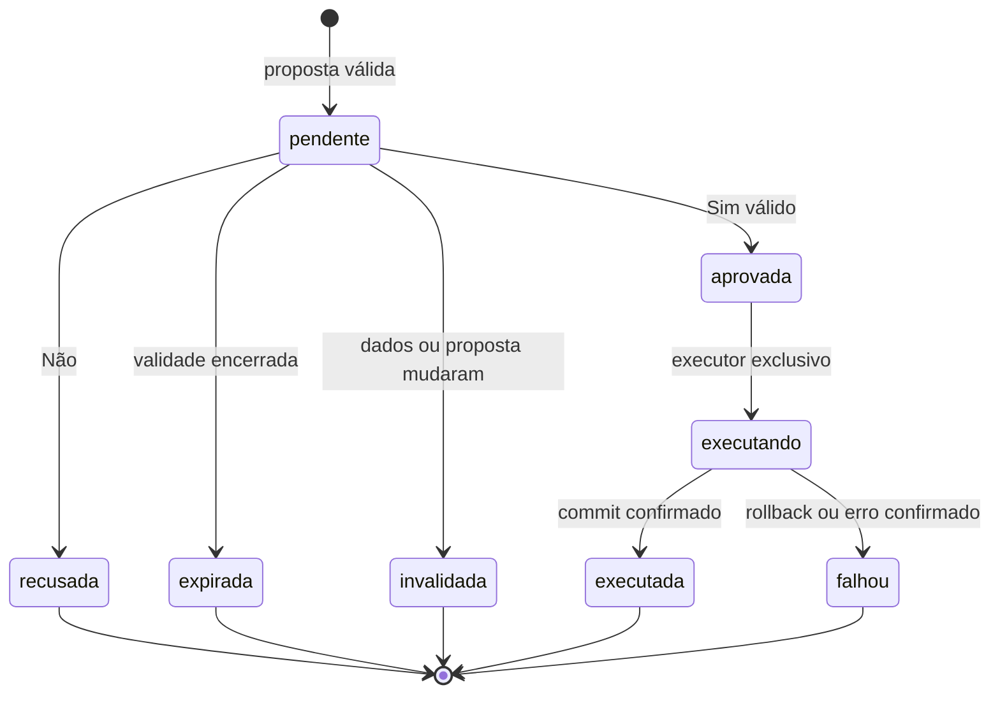

# Human-in-the-Loop e autorização

## Política de negócio

**Decisão confirmada:** toda alteração de negócio no SAP simulado ou nos chamados precisa de autorização humana específica. A IA solicita uma ação com uma frase explicativa; o servidor decide se a operação é permitida, apresenta os dados e aguarda a decisão. O modelo nunca concede autorização a si mesmo.

| Classe | Exemplos | Comportamento confirmado |
| --- | --- | --- |
| Leitura | Consultar pedido, histórico ou base | Automático dentro da sessão autorizada. |
| Operação técnica | Mensagens, chamadas de LLM/embeddings, auditoria e criação de proposta pendente | Automático, sem alterar dados de negócio. |
| Alteração de negócio | Registrar recebimento; modificar situação do chamado | Exige Sim válido antes de executar. |
| Operação não permitida | Alterar tolerâncias, permissões, Customizing ou executar código/HTTP arbitrário | Bloquear; aprovação não torna uma operação proibida permitida. |

O transporte não define o risco: busca via POST continua sendo leitura; um GET com efeito colateral não pode escapar da autorização. Essa é a interpretação confirmada de “tudo que não for GET”. A política é da aplicação; não se aplica às edições de documentação autorizadas pelo usuário no desenvolvimento.

**Recomendação:** expor ao modelo `registrar_recebimento_simulado` e `atualizar_status_chamado` somente como tipos de proposta. Na primeira versão, a atualização de status permite `em_validacao_humana` e `resolvido`. Cada alteração é uma proposta separada e precisa de sua própria decisão. Não resolver o chamado automaticamente ao registrar um recebimento.

Sinalizar necessidade de revisão na resposta e criar evento técnico pode ocorrer automaticamente. Alterar a situação de negócio do chamado para “em validação humana” requer aprovação. A recusa dessa alteração não elimina o aviso de risco nem autoriza outra operação.

## Proposta e decisão

**Decisão confirmada:** registrar operação, parâmetros, frase, chamado, sessão, versões dos dados, validade de 15 minutos e estado. O servidor cria ID e timestamps, calcula o resumo concreto da alteração e vincula a decisão à proposta exata.

**Recomendação:** canonicalizar operação/parâmetros/identidade/versões para um hash de integridade, armazenado no servidor. O hash não é credencial de aprovação. Usar contexto de sessão validado e proteção contra requisições forjadas/replay; o LLM não recebe segredos ou mecanismos de decisão.

Para recebimento, exigir pedido/item existentes, material e localização válidos, quantidade decimal positiva, unidade consistente, data explícita e saldo suficiente conforme as [regras simuladas](02-processo-sap.md). Para status, validar chamado acessível e transição permitida. Valores inválidos não geram cartão executável.

**Decisão confirmada:** a decisão aceita apenas o ID e a escolha humana; a operação não pode ser modificada no clique. Mudança nos parâmetros, versões ou efeito da ação invalida a aprovação. Uma correção produz nova proposta e nova pergunta.

## Estados

**Recomendação:** representar os seguintes estados no banco e na interface.

O relógio do servidor em UTC define o vencimento; a interface apresenta o horário em America/Sao_Paulo. Não confiar no relógio do navegador. Aguardar sem resposta nunca implica consentimento.

## Execução atômica e repetição

**Recomendação:** ao receber Sim, iniciar transação, bloquear a proposta e os registros de negócio afetados, validar identidade, estado, validade, integridade e versões. Registrar decisão e executar somente a operação armazenada. Confirmar efeito, estado final e auditoria na mesma transação do simulador.

Persistir estados intermediários e eventos de aprovação dentro da transação; a operação simulada e sua conclusão devem ser atômicas. Usar unicidade por proposta/execução como proteção adicional. Em falha, reverter dados de negócio e registrar o resultado técnico por caminho controlado. Uma aprovação já expirada ou cujo dado mudou não deve ficar marcada como sucesso.

Dois cliques ou workers concorrentes disputam a mesma proposta; apenas um pode executar. Repetição após sucesso retorna o resultado armazenado. Uma falha não autoriza tentativa automática futura: nova tentativa de negócio exige nova proposta. Propostas órfãs, sem contexto verificável, não são executadas na inicialização.

Um futuro adaptador SAP remoto exigirá idempotência e conciliação de resultados incertos; a transação local não garante atomicidade em outro sistema. Isso é evolução posterior, não capacidade da simulação.

## Barreira fora do modelo

**Decisão confirmada:** o registro de ferramentas não inclui `aprovar`, `decidir_aprovacao` ou acesso ao executor. Texto do chat, documentos recuperados e respostas do provedor não são fontes de autorização.

**Recomendação:** manter o executor em módulo interno e validar invariantes também no gateway, mesmo que a UI já desabilite botões. Não aceitar SQL, URLs ou métodos arbitrários como parâmetros de ferramentas. Registrar estado anterior/posterior, autor da decisão, proposta, sessão, resultado e horário, sem segredos.

**Aceite recomendado:** nenhuma escrita de negócio ocorre sem decisão válida; Não e silêncio preservam dados; aprovação não é reutilizável para outro payload; sessões não interferem; rerun/restart e clique repetido não repetem operação. Cenários detalhados em [testes](08-testes-e-avaliacao.md).
